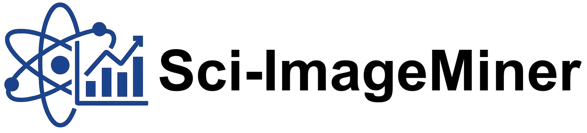
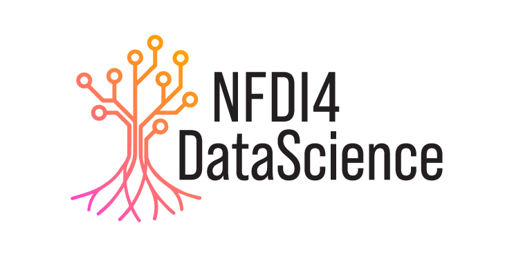

<div align="center">
  
</div>

## Project Overview  

**Sci-ImageMiner** is an annotation project on figures from **atomic layer deposition (ALD)** and **atomic layer etching (ALE)**, situated within the broader field of materials science and engineering. Within each of these categories, the data is further organized into the sub-categories **experimental-usecase** and **simulation-usecase**.

It aims to host gold-standard annotations for chart classification, data extraction, summarization, and question answering—providing both pilot and full-phase data to support multimodal AI research in scientific image understanding.   

### 🗂️ Directory Structure  

We have compiled the dataset for annotation in this repository, structured into clearly defined categories and sub-categories.  
The layout reflects the distinction between ALD and ALE literature, as well as between experimental and simulation studies, making it easier to navigate both the pilot and full annotation phases.  


```text
data
├── alde-imageminer
│   ├── train
│   │   ├── atomic-layer-deposition
│   │   │   ├── experimental-usecase
│   │   │   │   ├── paper #
│   │   │   │   │   ├── images
│   │   │   │   │   │   ├── figures
│   │   │   │   │   │   │   ├── filename.jpg          # (JPEG) actual figure image extracted using MinerU
│   │   │   │   │   │   │   └── filename.json        # (JSON) expert annotated JSON
│   │   │   │   ├── Author et al.pdf                # (PDF) actual PDF document
│   │   │   │   ├── content.json                    # (JSON) structured content extracted using MinerU
│   │   │   └── ...
│   │   └── simulation-usecase
│   │       └── ...
│   └── atomic-layer-etching
│       └── ...
└── dev/test
    ├── atomic-layer-deposition
    │   ├── experimental-usecase
    │   └── simulation-usecase
    └── atomic-layer-etching
        ├── experimental-usecase
        └── simulation-usecase
```

## 🛠️ Tools Used

- **[MinerU](https://github.com/opendatalab/MinerU)** → structured text, figures, formulas, and tables from PDFs. It is created by OpenDataLab as an open-source tool designed for data extraction from PDF documents, converting them into structured machine-readable formats like Markdown and JSON. MinerU can interpret the complex layout structure of research papers, including figures, tables, formulas, and text.
- **[Qwen2.5-VL](https://github.com/QwenLM/Qwen2.5-VL)** → multimodal LLM applied for classification, extraction, and summarization. Specifically, we used [Qwen2.5-VL-7B-Instruct](https://huggingface.co/Qwen/Qwen2.5-VL-7B-Instruct).
- **[Prompts](code/baseline/prompts)** folder documents the prompts used for information extraction (figure type, data, summary, and VQA).  


### 📊 Dataset Statistics

#### Overall

| Split Name | ALD-Experimental-UseCase-Papers | ALD-Experimental-UseCase-Figures | ALD-Simulation-UseCase-Papers | ALD-Simulation-UseCase-Figures | ALE-Experimental-UseCase-Papers | ALE-Experimental-UseCase-Figures | ALE-Simulation-UseCase-Papers | ALE-Simulation-UseCase-Figures | Total-Papers | Total-Figures |
|---|---|---|---|---|---|---|---|---|---|---|
| Train | 42 | 330 | 35 | 349 | 27 | 248 | 22 | 243 | 126 | 1170 |
| Dev | 6 | 50 | 6 | 59 | 5 | 55 | 3 | 37 | 20 | 201 |
| Test | 18 | 172 | 17 | 149 | 14 | 138 | 10 | 121 | 59 | 580 |
| Total | 66 | 552 | 58 | 557 | 46 | 441 | 35 | 401 | 205 | 1951 |

#### Figure type Distribution

We have defined a taxonomy of 39 figure types including "unknown". The full taxonomy with descriptions, parent taxonomy category, and aliases is here [figure_taxonomy.tsv](https://github.com/sciknoworg/ALD-E-ImageMiner/blob/main/figure_taxonomy.tsv). The ALD/E-ImageMiner project maintains a focus only on figures of parent taxonomy category `quantitative plot`.


| Figure Type                     | Train | Dev | Test |
|---------------------------------|-------|-----|------|
| 3d scatter plot                 | 10    | 0   | 4    |
| apparatus diagram               | 51    | 1   | 28   |
| area chart                      | 1     | 0   | 0    |
| band diagram                    | 5     | 0   | 8    |
| bar chart                       | 35    | 2   | 13   |
| box plot                        | 6     | 0   | 4    |
| chromaticity diagram            | 1     | 0   | 0    |
| conceptual diagram              | 146   | 35  | 45   |
| contour heatmap                 | 38    | 0   | 8    |
| device structure diagram        | 10    | 2   | 4    |
| formula                         | 2     | 0   | 0    |
| grouped bar chart               | 9     | 0   | 3    |
| heatmap                         | 75    | 0   | 28   |
| image panel                     | 235   | 33  | 86   |
| line chart                      | 114   | 29  | 51   |
| molecular structure diagram     | 388   | 101 | 250  |
| multi spectra chart             | 153   | 10  | 94   |
| multi-axis chart                | 82    | 5   | 48   |
| multiple line chart             | 263   | 49  | 131  |
| multiple scatter plot           | 176   | 15  | 74   |
| network diagram                 | 0     | 0   | 2    |
| periodic table map              | 1     | 0   | 2    |
| phase diagram                   | 4     | 0   | 3    |
| pie chart                       | 4     | 0   | 0    |
| polar chart (rose chart)        | 2     | 0   | 0    |
| process flow diagram            | 43    | 2   | 9    |
| process timing diagram          | 16    | 12  | 11   |
| reaction energy profile diagram | 61    | 0   | 24   |
| reaction scheme                 | 130   | 32  | 43   |
| scatter plot                    | 133   | 16  | 63   |
| spectra chart                   | 74    | 2   | 42   |
| stacked bar chart               | 7     | 0   | 0    |
| stacked spectra chart           | 114   | 7   | 37   |
| table                           | 3     | 0   | 0    |
| timeline chart                  | 1     | 2   |      |
| unknown                         | 29    | 7   | 11   |
| workflow diagram                | 6     | 0   | 1    |
| **Total** | **2428** | **362** | **1127** |

## 📜 License

### Annotations and Metadata
All annotations, labels, bounding boxes, and structured metadata in this repository are licensed under CC BY 4.0 (see [LICENSE](data/LICENSE.md) file).

You are free to use, modify, and redistribute the annotations with proper attribution.

### Article PDFs, Images and Text Content
Images were extracted from published scientific articles. Copyright remains with the original authors and/or publishers.

Images are provided for research purposes only. Users are responsible for complying with the licensing terms of the original publications.

## 📖 Citation

The **Sci-ImageMiner project vision** is described in the following working paper, pre-released on Zenodo. Please cite this paper if you find the project useful:

```bibtex
@misc{d_souza_2025_17130928,
  author       = {D'Souza, Jennifer},
  title        = {A Pathway to General-Purpose Scientific AI:
                   Multimodal Comprehension of Scientific Images},
  month        = sep,
  year         = 2025,
  publisher    = {Zenodo},
  doi          = {10.5281/zenodo.17130928},
  url          = {https://doi.org/10.5281/zenodo.17130928},
}
```

Sci-ImageMiner was also featured as the **[ICDAR 2026 Competition on Information Extraction from Atomic Layer Deposition/Etching (ALD/E) Scientific Figures](https://sites.google.com/view/sci-imageminer/)**, organized as part of the [ICDAR 2026 competitions](https://icdar2026.org/index.php/competitions/). Please cite the official proceedings report when referring to the benchmark, dataset, competition, or associated information-extraction tasks:

```bibtex
@InProceedings{10.1007/978-3-032-36042-7_19,
  author    = {Ahmed, Fahad and D' Souza, Jennifer and Auer, S{\"o}ren},
  editor    = {Fink, Gernot A. and Forn{\'e}s, Alicia and Kise, Koichi and Lopresti, Daniel},
  title     = {ICDAR 2026 Competition on Information Extraction from
               Atomic Layer Deposition/Etching (ALD/E) Scientific Figures},
  booktitle = {Document Analysis and Recognition -- ICDAR 2026},
  year      = {2027},
  publisher = {Springer Nature Switzerland},
  address   = {Cham},
  pages     = {319--335},
  doi       = {10.1007/978-3-032-36042-7_19},
  url       = {https://doi.org/10.1007/978-3-032-36042-7_19}
}
```


## ⭐ Acknowledgements  

Within **Sci-ImageMiner**, the development of the **expert-annotated ALD/E-ImageMiner benchmark resource** was funded by:

-   

  The [NFDI4DataScience](https://www.nfdi4datascience.de/) initiative, funded by the **German Research Foundation (DFG, Grant ID: 460234259)** under the *[Speedboat Annotation Project](https://www.nfdi4datascience.de/community/speed-boat-projects/)* funding scheme.  

This research endeavor in conducted in the context of the following project:

- The *AI-Aware Pathways to Sustainable Semiconductor Process and Manufacturing Technologies (AWASES)* initiative (Mackus et al., 2024), funded by **Merck and Intel**, with collaboration between **Eindhoven University**, **Leibniz University Hannover’s L3S Research Centre**, and **University of Warwick**. AWASES hosts three fully funded PhD positions and supports advances in **generative AI, multimodal models, and FAIR scientific knowledge graph construction**.
